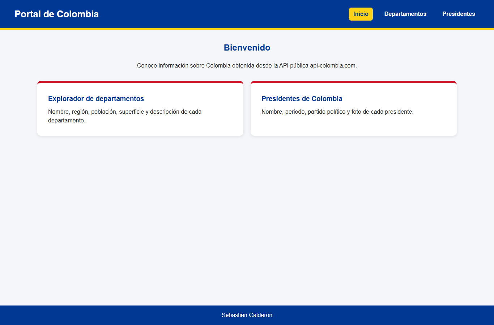
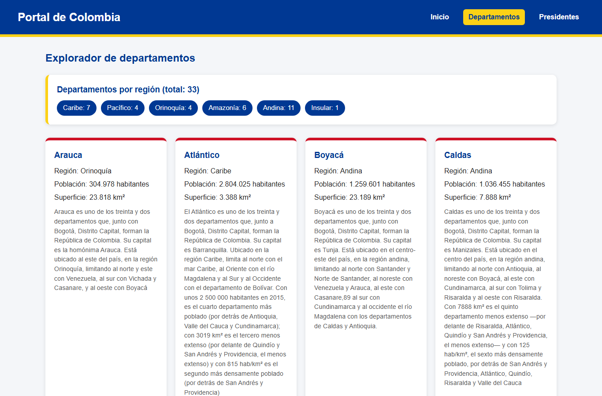
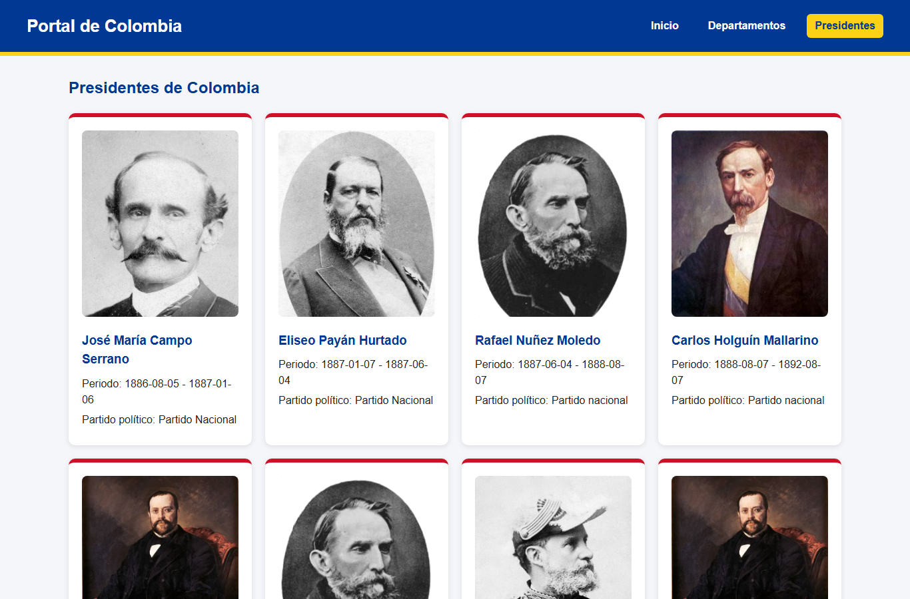

# Portal de Colombia con API

## Descripción

Mini portal web informativo sobre Colombia que consume datos de la API pública [api-colombia.com](https://api-colombia.com/) y los muestra dinámicamente en el DOM con JavaScript.

El portal tiene dos secciones conectadas mediante hipervínculos:

- **Explorador de departamentos:** muestra el nombre, la región, la población, la superficie y la descripción de los 33 departamentos de Colombia. Incluye un resumen con la cantidad de departamentos por región.
- **Presidentes de Colombia:** muestra el nombre, el periodo, el partido político y la foto de cada presidente, ordenados por año de inicio del periodo.

Mientras se cargan los datos se muestra un mensaje de carga y, si ocurre un error al consultar la API, se informa en pantalla.

### Endpoints utilizados

| Endpoint | Uso |
|---|---|
| `/api/v1/Department` | Datos de los departamentos |
| `/api/v1/Region` | Nombre de la región de cada departamento |
| `/api/v1/President` | Datos de los presidentes |

### Imágenes

Algunas imágenes de presidentes que entrega la API no cargan o no existen, porque el archivo fue eliminado o el enlace dejó de funcionar. Esas imágenes se reemplazaron por enlaces válidos de Wikimedia Commons, de la Enciclopedia del Banco de la República y del archivo audiovisual de la Universidad Icesi. Si alguna imagen deja de cargar, se muestra una imagen genérica de "sin foto".

## Tecnologías usadas

- HTML5
- CSS3 (Flexbox, Grid y media queries)
- JavaScript (fetch, async/await, promesas y manipulación del DOM)
- Git y GitHub

## Estructura del proyecto

```
├── index.html
├── departamentos.html
├── presidentes.html
├── css/
│   └── estilos.css
├── js/
│   ├── departamentos.js
│   └── presidentes.js
├── capturas/
│   ├── index.png
│   ├── departamentos.png
│   └── presidentes.png
└── README.md
```

## Instrucciones de uso

1. Clonar el repositorio:

   ```bash
   git clone https://github.com/c4lde/sebastian-calderon-api-colombia.git
   ```

2. Abrir la carpeta del proyecto en Visual Studio Code.
3. Abrir `index.html` con la extensión **Live Server**.
4. Navegar entre las secciones desde el menú superior.

Se necesita conexión a internet para consultar la API.

## Capturas

### Inicio



### Explorador de departamentos



### Presidentes de Colombia



## Estudiante

Sebastian Calderon
